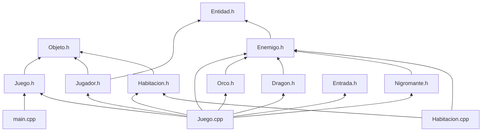

# Recorrido del codigo (orden de estudio)

Este documento es para alguien que **no escribio** el codigo y tiene que entenderlo y explicarlo. Leelo con el codigo abierto al lado. No hay numeros de linea porque cambian: busca cada cosa por el nombre de la clase y del metodo (en CLion, `Ctrl+N` busca una clase y `Ctrl+F12` lista los metodos del archivo abierto).

Orden recomendado:

1. Como se conectan `.h`, `.cpp` y `main`.
2. `Entidad` -> `Jugador` y `Objeto` -> `Enemigo` -> `Orco`, `Dragon` y `Nigromante` -> `Habitacion` -> `Juego` -> `main`. Y el modulo `Entrada`.
3. Traza de un turno de combate.
4. Traza de la memoria: que se crea, donde vive y quien lo libera.

---

## 1. Como se conectan los archivos

Cada clase tiene dos archivos:

- **`Clase.h` (declaracion):** dice *que* tiene la clase: atributos y firmas de metodos. Esta protegido con un *header guard* (`#ifndef CLASE_H` / `#define CLASE_H` / `#endif`) para que, si se incluye dos veces, el compilador lo lea una sola vez.
- **`Clase.cpp` (definicion):** dice *como* funciona cada metodo. Empieza con `#include "Clase.h"` y define cada metodo con el nombre completo, por ejemplo `void Orco::atacar(Entidad& objetivo) { ... }`.

El compilador traduce cada `.cpp` por separado y despues el *enlazador* une todo en `AventuraTextual`. `CMakeLists.txt` lista todos los archivos que forman el programa.

### Grafo real de `#include` entre archivos del proyecto



Ademas, cada `.cpp` incluye su propio `.h` (`Entidad.cpp` -> `Entidad.h`, etc.); no se dibujo para no llenar el grafo.

### Forward declaration

Fijate en tres lugares donde **no** hay `#include` y en cambio hay una linea como `class Habitacion;`:

- `Jugador.h` declara `class Habitacion;` porque solo guarda un `Habitacion*`.
- `Habitacion.h` declara `class Enemigo;` porque solo guarda `Enemigo*`.
- `Juego.h` declara `class Enemigo; class Habitacion; class Jugador;`.

Para guardar un **puntero** basta con saber que la clase existe. El `#include` completo se pone en el `.cpp`, que es donde de verdad se llaman sus metodos. Asi se evitan *dependencias circulares*: `Habitacion` conoce a `Enemigo` y `Jugador` conoce a `Habitacion` sin que los `.h` se incluyan en circulo.

---

## 2. Clase por clase

### 2.1 `Entidad` (Entidad.h / Entidad.cpp)

- **Para que existe:** es la base de todo lo que pelea. Junta lo comun: nombre, vida, vida maxima y ataque.
- **Atributos:** `nombre`, `vida`, `vidaMaxima` y `ataque`, todos `protected` (las derivadas los usan directamente).
- **Metodos clave:**
  - `atacar(Entidad& objetivo)` es **virtual puro** (`= 0`): no tiene codigo aqui y obliga a cada derivada a escribir el suyo. Por eso `Entidad` es **abstracta** y no se puede hacer `Entidad e(...)`.
  - `recibirDanio` resta vida y la deja en 0 como minimo (ternario). Muestra `X queda con V/M de vida.` y, si murio, `X ha sido derrotado.`.
  - `curar` suma vida sin pasar de `vidaMaxima` (ternario).
  - El destructor `virtual ~Entidad()` permite hacer `delete` desde un puntero a la base.
- **Relaciones:** herencia (es la base de `Jugador` y `Enemigo`).
- **Que mirar:** el constructor de `Entidad` (lista de inicializacion con ternarios), `Entidad::recibirDanio` y la linea `virtual void atacar(Entidad& objetivo) = 0;` en el `.h`.
- **Ejemplo:** si un orco con 36 de vida recibe 40 de dano, `recibirDanio` calcula -4 y el ternario lo deja en 0.

### 2.2 `Objeto` (Objeto.h / Objeto.cpp)

- **Para que existe:** representa una pocion o un arma.
- **Atributos:** `nombre`, `descripcion`, `tipo` (`TipoObjeto::PocionDeVida` o `TipoObjeto::Arma`) y `valor` (cuanto cura o cuanto ataque da).
- **Metodos clave:** solo el constructor y getters. Es una clase de datos.
- **Relaciones:** composicion: vive dentro del `inventario` de `Jugador` y dentro de `objetos` de `Habitacion`, siempre **por valor**.
- **Que mirar:** el comentario sobre `enum class TipoObjeto` en `Objeto.h`, que explica por que no hay clases hijas (slicing).
- **Ejemplo:** `Objeto pocion("Pocion de Vida", "Restaura 40 puntos de vida.", TipoObjeto::PocionDeVida, 40);` en `Juego::colocarObjetos`.

### 2.3 `Jugador` (Jugador.h / Jugador.cpp)

- **Para que existe:** es el personaje de quien juega.
- **Atributos:** `inventario` (`std::vector<Objeto>`), `bonusAtaque` (del arma), `ubicacion` (`Habitacion*`), `nivel` y `experiencia`.
- **Metodos clave:**
  - `atacar`: dano = `ataque + bonusAtaque`; llama a `objetivo.recibirDanio(dano)`.
  - `usarObjeto(int indice)`: segun el `tipo` del objeto llama a `beberPocion` o a `equiparArma`. Si el objeto se uso, lo borra del vector con `erase`. Devuelve `true` o `false` para que `Juego` sepa si se gasto el turno.
  - `ganarExperiencia(int xp)`: suma la XP y, **mientras** llegue a 50, resta 50 y llama a `subirNivel`.
  - `subirNivel()` (**privado**): `nivel++`, +20 de vida maxima, +3 de ataque base y `curar(20)`.
- **Relaciones:** herencia de `Entidad`; composicion con `Objeto`; asociacion con `Habitacion` (`ubicacion`). `Juego` lo posee.
- **Que mirar:** `Jugador::usarObjeto` (el `switch` sobre el tipo y el `erase`), `Jugador::ganarExperiencia` (el `while`) y `Jugador::subirNivel`.
- **Ejemplo:** con 40 XP, al derrotar a Zug (20 XP) llega a 60: resta 50, queda en 10 y sube al nivel 2. Si tenia 75/120 de vida, queda con 95/140.

### 2.4 `Enemigo` (Enemigo.h / Enemigo.cpp)

- **Para que existe:** es la clase intermedia de todo lo que pelea contra el jugador. `Habitacion` y `Juego` guardan `Enemigo*` sin saber si es orco, dragon o nigromante.
- **Atributos:** `recompensaXp` (privado).
- **Metodos clave:** `getTipo()` es virtual puro; `atacar` se hereda sin implementar. Por eso `Enemigo` **sigue siendo abstracta**. `getRecompensaXp()` devuelve la experiencia que vale.
- **Relaciones:** herencia de `Entidad` y base de `Orco`, `Dragon` y `Nigromante`; agregacion con `Habitacion`; composicion con `Juego`.
- **Que mirar:** que `Enemigo.h` no declara `atacar`, y el destructor virtual.

### 2.5 `Orco`, `Dragon` y `Nigromante`

Las tres clases tienen la misma forma: un constructor que llama a `Enemigo(...)` con sus estadisticas, `atacar(...) override` y `getTipo() const override`. **Lo unico que cambia es como atacan:**

| Clase | Vida / ataque / XP | `atacar` |
|---|---|---|
| `Orco` | 36 / 7 / 20 | Si `vida * 2 < vidaMaxima` (menos de la mitad) entra en furia: +3 de dano. Lo decide el metodo privado `estaEnFuria`. |
| `Dragon` | 80 / 12 / 60 | Lleva `ataquesRealizados`. Si es multiplo de 3 (`% 3 == 0`), aliento de fuego: +8 de dano. |
| `Nigromante` | 90 / 10 / 0 | Lleva `ataquesRealizados`. Si es multiplo de 2, **drenaje**: se cura lo mismo que hace de dano (con `curar`, que respeta el tope) y muestra cuanto recupero de verdad. |

- **Relaciones:** herencia de `Enemigo`.
- **Que mirar:** `Orco::atacar`, `Dragon::atacar` y `Nigromante::atacar` uno al lado del otro: misma firma, comportamiento distinto. Es la base del polimorfismo.
- **Ejemplo:** el Nigromante con 42/90 hace su 2.o ataque: `curar(10)` lo deja en 52, muestra `recupera 10 de vida` y el jugador recibe 10 de dano.

### 2.6 `Habitacion` (Habitacion.h / Habitacion.cpp)

- **Para que existe:** es un lugar del mapa.
- **Atributos:**
  - `salidas`: `std::map<std::string, Habitacion*>`, por ejemplo `"norte" -> Salon de Guardia` (**asociacion**).
  - `enemigos`: `std::vector<Enemigo*>` (**agregacion**: solo los registra).
  - `objetos`: `std::vector<Objeto>` (**composicion**: los objetos del suelo, por valor).
- **Metodos clave:**
  - `conectar` agrega una salida en **un solo sentido**.
  - `retirarEnemigosDerrotados` arma un vector nuevo solo con los vivos. **No hace `delete`**.
  - `retirarObjeto` devuelve una copia del objeto y lo borra del suelo.
  - `describir` muestra el nombre, la descripcion, los enemigos, los objetos y las salidas.
- **Relaciones:** asociacion consigo misma, agregacion con `Enemigo` y composicion con `Objeto`. `Juego` la posee.
- **Que mirar:** los comentarios de los tres atributos en `Habitacion.h`, `Habitacion::retirarEnemigosDerrotados` y `Habitacion::mostrarSalidas` (recorre el `std::map` en orden alfabetico).
- **Ejemplo:** el Salon de Guardia muestra `Salidas: este, norte, sur` aunque se conecto en otro orden, porque `std::map` ordena sus claves.

### 2.7 `Juego` (Juego.h / Juego.cpp)

- **Para que existe:** arma el mundo, maneja los menus y el combate, y es el **unico dueno** de la memoria dinamica.
- **Atributos:** `jugador` (`Jugador*`), `habitaciones` (`std::vector<Habitacion*>`), `enemigos` (`std::vector<Enemigo*>`) y `habitacionFinal` (`Habitacion*`, la Sala del Trono).
- **Como esta organizado `Juego.cpp`** (en este orden dentro del archivo):
  1. **Constantes:** valores de objetos, posicion de cada habitacion (`INDICE_ENTRADA`...), opciones de menu y textos.
  2. **Creacion y destruccion:** el constructor pone los punteros en `nullptr`; `~Juego` hace todos los `delete`.
  3. **Preparacion:** `iniciar` llama a `construirMundo`, que se lee como una frase: `crearHabitaciones`, `conectarHabitaciones`, `colocarEnemigos`, `colocarObjetos`.
  4. **Exploracion:** `menuExploracion` es un `do-while` que muestra el menu (`mostrarMenuExploracion`) y ejecuta la opcion (`ejecutarOpcionExploracion`, con un `switch`). `moverse` usa `elegirDestino` y, si hay enemigos, llama a `combatir`.
  5. **Combate:** `combatir`, `atacarEnemigo`, `contraatacar`, `elegirObjetivo`.
- **Que mirar:**
  - `Juego::contraatacar`: **la linea del polimorfismo** (`enemigo->atacar(*this->jugador);`).
  - `Juego::colocarEnemigo`: el mismo puntero se guarda en `this->enemigos` (composicion) y en la habitacion (agregacion).
  - `Juego::atacarEnemigo`: da la experiencia antes de retirar a los derrotados.
  - `Juego::comprobarVictoria`: se gana solo en la `habitacionFinal` sin enemigos vivos.
  - `Juego::~Juego`: los `delete`.

### 2.8 `main` (main.cpp)

Solo crea `Juego juego;` (en el **Stack**), llama a `juego.iniciar()` y devuelve 0. Al terminar `main`, `juego` sale de alcance y su destructor libera todo lo que estaba en el Heap.

### 2.9 Modulo `Entrada` (Entrada.h / Entrada.cpp)

No es una clase: son dos funciones libres.

- `leerLinea` lee una linea completa con `std::getline` y devuelve `false` si se acabo la entrada (EOF).
- `leerOpcion` repite la pregunta hasta recibir un numero valido dentro del rango. Solo acepta digitos y como mucho 6 caracteres; recien entonces usa `std::stoi`, que asi nunca falla. Si se acabo la entrada devuelve `ENTRADA_AGOTADA` (-1) y cada menu lo trata como "salir".

---

## 3. Traza de un turno de combate

Situacion: el jugador (nivel 1, 113/120) pelea contra Gruk (24/36) en el Salon de Guardia y elige `1. Atacar`. Es el segundo turno de `tests/ganar.in`.

```
Juego::combatir()                         bucle: el jugador vive y hay enemigos vivos
 |- Juego::mostrarMenuCombate()           "--- COMBATE ---", "Heroe (nivel 1): 113/120", enemigos y acciones
 |- leerOpcion(...)                       el jugador escribe 1 -> ACCION_ATACAR
 |- Juego::atacarEnemigo()
 |   |- Juego::elegirObjetivo()           hay un solo enemigo: devuelve Gruk sin preguntar
 |   |- Jugador::atacar(Gruk)             dano = ataque 12 + bonus 0 = 12
 |   |   '- Entidad::recibirDanio(12)     (sobre Gruk) 24 -> 12: "Gruk queda con 12/36 de vida."
 |   |- Gruk sigue vivo: no hay experiencia
 |   '- Habitacion::retirarEnemigosDerrotados()   nadie murio: el vector queda igual
 |   devuelve true -> se gasto el turno
 '- Juego::contraatacar()
     '- para cada Enemigo* de la habitacion:
         enemigo->atacar(*jugador)        <- llamada VIRTUAL
          '- en ejecucion corre Orco::atacar (el objeto real es un Orco)
              |- estaEnFuria(): 12 * 2 < 36 -> si
              |- "El orco Gruk entra en furia y golpea a Heroe (10 de dano)."
              '- Entidad::recibirDanio(10)   (sobre el jugador) 113 -> 103
```

En el turno siguiente, Gruk llega a 0. Entonces `atacarEnemigo` ve que `!objetivo->estaVivo()`, llama a `Jugador::ganarExperiencia(20)` y `retirarEnemigosDerrotados` saca a Gruk del vector de la habitacion. Como el vector queda vacio, `contraatacar` no hace nada, el `while` de `combatir` termina y muestra `Has derrotado a todos los enemigos.`.

**Si el enemigo fuera el Nigromante**, la llamada `enemigo->atacar(*jugador)` seria exactamente la misma linea, pero en ejecucion correria `Nigromante::atacar`. Eso es el polimorfismo.

---

## 4. Traza de la memoria: Stack y Heap

- **Stack (pila):** variables locales. Se crean al entrar a una funcion y se destruyen solas al salir de ella.
- **Heap (monton):** memoria pedida con `new`. Vive hasta que alguien hace `delete`. Si nadie lo hace, hay una **fuga de memoria**.

```
main()
 '- Juego juego;                  STACK: el objeto juego (sus 4 atributos)
     '- juego.iniciar()
         |- new Jugador("Heroe")       HEAP: 1 Jugador; juego.jugador apunta a el
         '- construirMundo()
             |- crearHabitaciones()    HEAP: 6 Habitacion (new en crearHabitacion);
             |                         sus punteros quedan en juego.habitaciones
             |- conectarHabitaciones() solo se guardan punteros en cada std::map (nada nuevo)
             |- colocarEnemigos()      HEAP: 3 Orco, 1 Dragon, 1 Nigromante (new);
             |                         cada puntero va a juego.enemigos Y a su habitacion
             '- colocarObjetos()       las pociones y la espada son locales (STACK) y se
                                       COPIAN dentro del vector de cada habitacion
 ... partida ...
 fin de main: juego sale de alcance -> se llama a Juego::~Juego()
     |- delete jugador                 libera el Jugador (y su inventario se libera solo)
     |- delete cada Habitacion         6 deletes (sus vectores y su map se liberan solos)
     '- delete cada Enemigo            5 deletes; gracias al destructor virtual se
                                       destruye el objeto completo (Orco, Dragon, Nigromante)
```

Cuentas: 12 `new` (1 + 6 + 5) y 12 `delete`, cada uno una sola vez.

Detalles que suelen preguntar:

- Los **contenedores** (`std::vector`, `std::map`, `std::string`) piden su propia memoria en el Heap por dentro, pero la liberan solos en su destructor. Por eso solo nos preocupamos por nuestros `new`.
- Un enemigo derrotado **no** se libera en el combate: solo sale del vector de la habitacion. Sigue en `juego.enemigos` hasta `~Juego`. Por eso no hay doble `delete` ni punteros colgantes.
- `Habitacion` no tiene destructor propio: no es duena de nada que este en el Heap.
