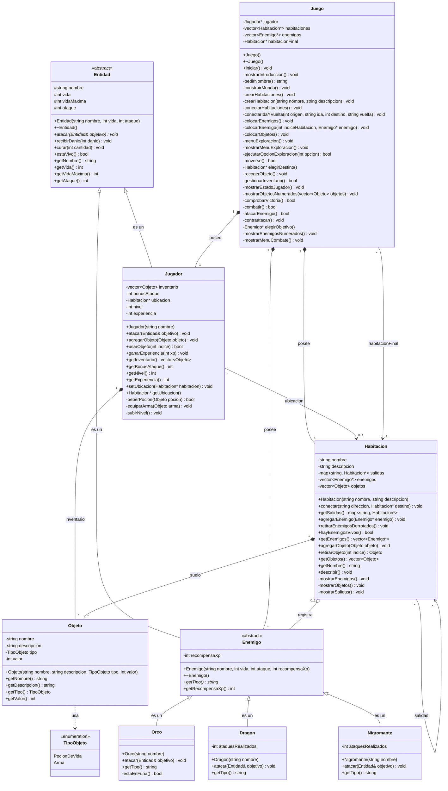

# Diagrama de clases (UML)

Proyecto: *La Cripta del Dragon de Ceniza* (version final, con niveles y el jefe Nigromante).

`Entrada` no aparece en el diagrama porque no es una clase: es un modulo de funciones libres (`leerLinea`, `leerOpcion`) que usa `Juego`.

El diagrama se verifico renderizandolo con `@mermaid-js/mermaid-cli`.

Convenciones del diagrama: `+` publico, `-` privado, `#` protegido. Las clases abstractas llevan `<<abstract>>` y los metodos virtuales puros un `*` despues de los parentesis (`+atacar(Entidad& objetivo)* void`). Un metodo que devuelve un puntero se escribe con el tipo al inicio (`+Habitacion* getUbicacion()`), porque un `*` al final de la linea lo marcaria como abstracto. Los tipos se escriben sin `const` ni `&` para que el diagrama se lea mejor, salvo en `atacar`.

## Relaciones

| Relacion | Tipo | Cardinalidad | Implementacion en C++ | Quien libera |
|---|---|---|---|---|
| `Entidad` <- `Jugador`, `Enemigo`; `Enemigo` <- `Orco`, `Dragon`, `Nigromante` | Herencia ("es un") | - | `: public` | - |
| `Juego` - `Jugador` | Composicion | 1 - 1 | `Jugador* jugador` (puntero propio) | `~Juego()` |
| `Juego` - `Habitacion` | Composicion | 1 - 6 | `std::vector<Habitacion*>` | `~Juego()` |
| `Juego` - `Enemigo` | Composicion | 1 - * (en el juego: 5) | `std::vector<Enemigo*>` | `~Juego()` |
| `Jugador` - `Objeto` | Composicion | 1 - * | `std::vector<Objeto>` (por valor) | automatico |
| `Habitacion` - `Objeto` | Composicion | 1 - * | `std::vector<Objeto>` (por valor) | automatico |
| `Habitacion` - `Enemigo` | Agregacion | 0..1 - * | `std::vector<Enemigo*>` (solo apunta) | no libera |
| `Habitacion` -> `Habitacion` (salidas) | Asociacion (auto-asociacion) | * - * | `std::map<std::string, Habitacion*>` | no libera |
| `Jugador` -> `Habitacion` (ubicacion) | Asociacion | * - 0..1 | `Habitacion* ubicacion` | no libera |
| `Juego` -> `Habitacion` (final: Sala del Trono) | Asociacion | * - 1 | `Habitacion* habitacionFinal` | no libera |

## Justificacion de las relaciones

- **Herencia:** un jugador y un enemigo *son una* entidad: comparten nombre, vida y ataque y cada uno ataca a su manera. Orco, Dragon y Nigromante *son un* enemigo.
- **Composicion `Jugador`-`Objeto` y `Habitacion`-`Objeto`:** los objetos nacen y mueren con quien los contiene (por valor).
- **Composicion `Juego`-(`Jugador`, `Habitacion`, `Enemigo`):** `Juego` los crea con `new` y es el unico que los destruye.
- **Agregacion `Habitacion`-`Enemigo`:** la habitacion solo *registra* a los enemigos presentes; existen sin ella (podrian moverse entre habitaciones) y no los libera. El Nigromante entra en esta relacion igual que los demas enemigos.
- **Asociacion:** el jugador "esta en" una habitacion, las habitaciones "se conectan con" otras y `Juego` "sabe cual es" la habitacion final; son relaciones de conocimiento entre objetos independientes.
